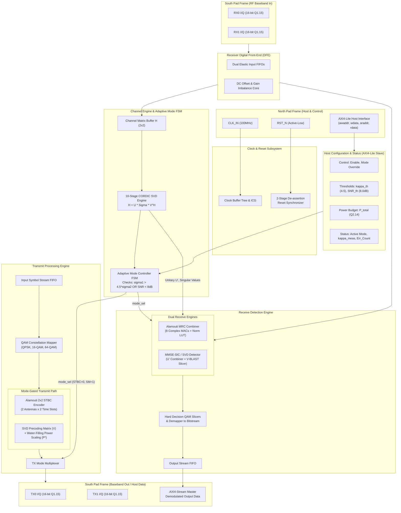

# Functional Block Diagram Specification
## Standalone 2x2 MIMO Baseband Processor ASIC (SMVDU-MIMO-180)

---

## 1. Top-Level Functional Block Architecture

---

## 2. Microarchitectural Block Breakdown

### Block 1: Transmit Engine (TX)
* **Symbol FIFO & Mapper:** Ingests raw data bits, maps to Gray-coded QPSK, 16-QAM, or 64-QAM constellations with unit average power ($E_s = 1$).
* **Alamouti STBC 2x2 Encoder:**
  $$\mathbf{X} = \frac{1}{\sqrt{2}} \begin{bmatrix} s_1 & -s_2^* \\ s_2 & s_1^* \end{bmatrix}$$
  * Operates with 2-clock latency using shift registers, sign negators, and multiplexers.
* **SVD Precoding & Water-Filling:**
  $$\mathbf{x} = \mathbf{V} \begin{bmatrix} \sqrt{P_1^*} s_1 \\ \sqrt{P_2^*} s_2 \end{bmatrix}$$
  * 4 complex multipliers scaling spatial streams by right unitary matrix $\mathbf{V}$ and allocated power $P_i^*$.

### Block 2: 16-Stage CORDIC SVD Decomposition Engine
* Computes singular values $\sigma_1, \sigma_2$ and unitary matrices $\mathbf{U}^H, \mathbf{V}$ from channel matrix $\mathbf{H}$ using two-sided iterative Givens rotations:
  $$\mathbf{H}_{k+1} = \mathbf{R}(\theta_L)^H \mathbf{H}_k \mathbf{R}(\theta_R)$$
* **Hardware Profile:** 16 unrolled coordinate rotation stages, 0 multipliers, shift-and-add logic only, fixed latency of 16 clock cycles.

### Block 3: Adaptive Rank-Switching Controller (FSM)
* Evaluates instantaneous channel condition number and SNR:
  $$\text{Condition: } \sigma_1 > 4.5 \cdot \sigma_2 \quad \text{OR} \quad \text{SNR} < 8.0\text{ dB}$$
* If true $\implies \text{mode\_sel} = 0$ (Alamouti STBC Diversity Mode).
* If false $\implies \text{mode\_sel} = 1$ (SVD-WF Spatial Multiplexing Mode).
* Replaces floating-point division with a single-cycle cross-multiplication comparator.

### Block 4: Advanced Detection Engine (RX)
* **Alamouti MRC Combiner:**
  $$\hat{s}_1 = \frac{h_{11}^* r_1(1) + h_{21}^* r_2(1) + h_{12} r_1^*(2) + h_{22} r_2^*(2)}{\|\mathbf{H}\|_F^2 / \sqrt{2}}$$
  * 8 complex multiply-accumulators (MACs) paired with a 256-word reciprocal normalization LUT.
* **MMSE-SIC Detector:**
  * Cancels detected stream $\hat{s}_1$ from received vector: $\mathbf{r}_{\text{cancelled}} = \mathbf{r} - \mathbf{h}_1 \hat{s}_1$.
  * Detects stream 2 via Maximal Ratio Combining (MRC), achieving diversity order $d=2$ on both spatial streams.

---

## 3. Clock & Reset Management
* **Single Primary Clock:** `clk` (100 MHz target, period $10.0\text{ ns}$).
* **Integrated Clock Gating (ICG):** Unused datapath modes (e.g. STBC during SM mode) are automatically clock-gated to conserve dynamic power.
* **Reset Strategy:** Synchronous core reset generated via an active-low asynchronous reset pad with a 2-stage de-assertion synchronizer.
